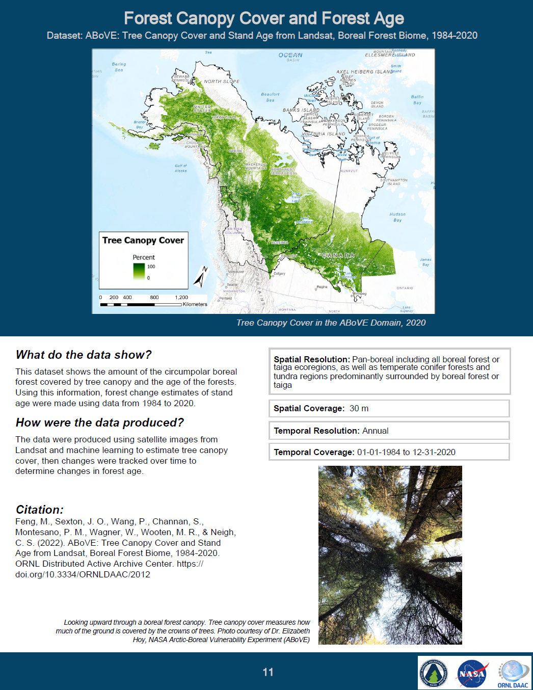
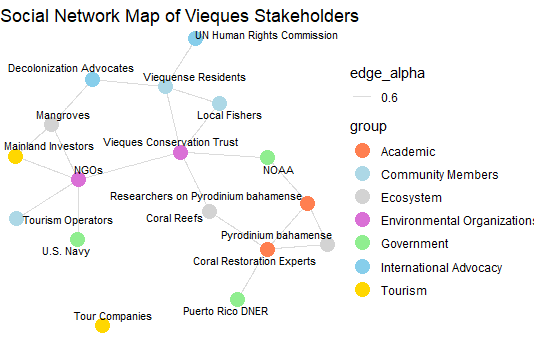

# Mary C. Banner  
Environmental GIS Analyst | Community-Centered Mapping | Earth Observation  

I am an Indigenous environmental scientist with a Master of Professional Studies in Environmental Science focused on ecology and a background in geographic information systems (GIS), remote sensing, fisheries, water system operations, and natural resource management. My work combines geospatial technology, environmental field experience, and community-centered approaches to understanding environmental change.

My professional experience includes NASA's Arctic-Boreal Vulnerability Experiment (ABoVE), NASA's Indigenous Peoples Initiative, fisheries work with the Yakama Nation, and drinking water system operations in western Washington. Across these roles, I have contributed to environmental mapping, Earth observation research, scientific communication, water quality monitoring, and natural resource management.

I am particularly interested in bridging Indigenous Knowledge and Western science through Two-Eyed Seeing, using geospatial tools to support Indigenous communities, environmental stewardship, and informed decision-making.

---

## GIS Portfolio

[View My Professional GIS Portfolio](MBanner_GIS_Portfolio.pdf)

---

## Featured Projects

### 🌎 NASA ABoVE Capstone – Communicating Complex Data Simply  
Developed GIS maps and regional booklet products using NASA NCCS climate and ecosystem datasets, translating Arctic-Boreal environmental data into accessible, community-centered visualizations for northern and Indigenous communities.
 

🔗 StoryMap: https://arcg.is/qDn5q0  
🔗 GitHub: https://github.com/BanBan2488/ABoVE-plain-language-products  

---

### 🌿 Vieques Bioluminescence Mapping – Mosquito Bay  

Mosquito Bay in Vieques, Puerto Rico is known for its year-round bioluminescence, driven by the dinoflagellate Pyrodinium bahamense. This project explores the ecological conditions that support this phenomenon while recognizing how tourism, land use, and the lasting impacts of military activity and colonialism shape the surrounding environment.

Social network map developed in R to visualize relationships between environmental systems, stakeholders, and historical influences, including coral reefs, mangroves, U.S. Navy activity, and community-led decolonization efforts.

Storymap: 🔗 https://arcg.is/1q1XHr

---

### 🌾 Effects of Anthropogenic Activities on Manoomin (Wild Rice)  
Performed GIS analysis to identify environmental impacts on wild rice ecosystems, highlighting spatial relationships affecting water quality, habitat health, and food sovereignty.

Storymap: 🔗 https://arcg.is/1v9ey02  

---

### 🧭 Indigenous Research Methodologies  
Applied Indigenous research frameworks alongside GIS tools to support community-centered environmental analysis and knowledge integration.

Storymap: 🔗 https://arcg.is/TD0eX  

---

### 🐙 Phylum Cnidaria Project  
Used GIS to map and analyze marine species distribution and ecological patterns, integrating spatial data with biological concepts.

Storymap: 🔗 https://arcg.is/1jGavm2  

---

## Technical Skills

**GIS & Mapping:** ArcGIS Pro, ArcGIS Online, StoryMaps, Survey123, QGIS  
**Remote Sensing:** Landsat, Sentinel-2, Earth observation datasets  
**Programming & Analysis:** Python (ArcPy, Jupyter), R  
**Data & Spatial Analysis:** Raster and vector workflows, spatial analysis, NetCDF processing  
**Data Sources:** NASA Earthdata, Oak Ridge National Laboratory Distributed Active Archive Center (ORNL DAAC), USGS, NOAA  

---

## Current Focus

- Building GIS workflows that support environmental and community-based applications  
- Developing accessible mapping products for natural resource and climate data  
- Expanding skills in Python and geospatial data analysis  

---

## Contact

- LinkedIn: https://linkedin.com/in/chefmaryb88  
- GitHub: https://github.com/BanBan2488 
- Resume: [Download Resume](Resume/MASTER_Resume_Oct.pdf) 
